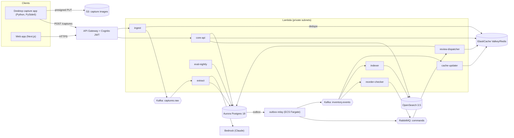
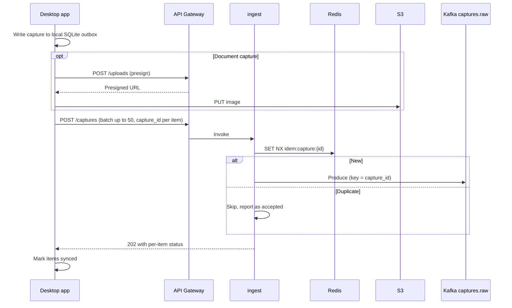
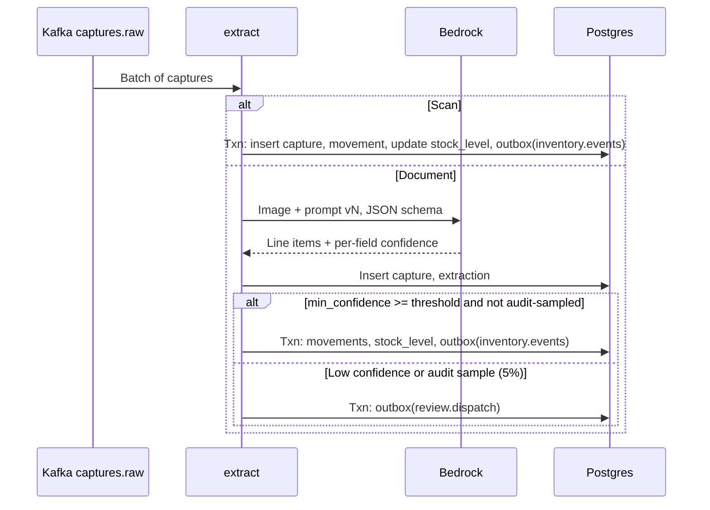
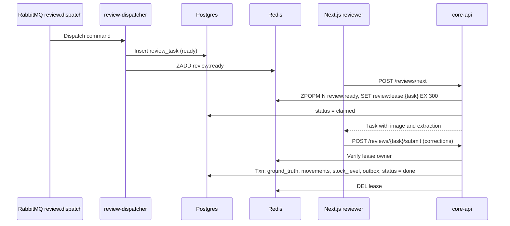

# Inventory Capture Platform — Design & Plan

**Status:** Draft v0.1 · **Owner:** Kevin Zhang · **Date:** 2026-10-22

## 1. Summary

A manufacturing receiving-dock system that captures inbound shipments from a Python desktop app (barcode scans and packing-slip photos), extracts line items from documents with an LLM, routes low-confidence extractions to a human review queue in a Next.js web app, and keeps stock levels, search and dashboards current with low latency.

The project is deliberately shaped to exercise high-throughput serverless pipelines on AWS using Kafka, RabbitMQ, Redis and OpenSearch (Elasticsearch-compatible), plus a human-in-the-loop (HITL) loop that produces ground truth for LLM evaluation.

## 2. Goals and non-goals

**Goals.** Reliable capture from many desktop stations, including offline operation. Exactly-once effect on stock levels despite at-least-once delivery. Sub-second reads for stock and search. A measurable LLM extraction pipeline with confidence routing, human correction and accuracy tracking per model and prompt version. Infrastructure fully reproducible with Terraform and torn down cheaply.

**Non-goals.** Full ERP, purchasing or accounting. Multi-region active-active. Mobile apps. Fine-tuning models (evaluation and prompt iteration only).

## 3. Requirements

### Functional

| ID | Requirement |
| --- | --- |
| F1 | Operators capture a barcode scan (SKU, qty, bin) or a packing-slip photo from the desktop app. |
| F2 | The desktop app queues captures locally and syncs when connectivity returns. |
| F3 | Document captures are extracted into structured line items (SKU or part number, qty, PO, supplier) with per-field confidence. |
| F4 | Extractions above the confidence threshold update stock automatically; others create review tasks. |
| F5 | Reviewers claim, correct and submit tasks in the web app; corrections update stock and are stored as ground truth. |
| F6 | Users search parts and documents (fuzzy part numbers, facets by category, supplier, site). |
| F7 | Stock levels per SKU and location are visible in the web app within seconds of capture. |
| F8 | Stock falling below a reorder point emits a reorder request. |
| F9 | An eval dashboard shows field-level accuracy and confidence calibration per model and prompt version. |

### Non-functional targets (to be validated in Phase 4)

| Metric | Target |
| --- | --- |
| Ingest API acknowledgement | p99 \< 150 ms |
| Scan → stock visible in web | p95 \< 2 s |
| Stock read (cache hit) | p99 \< 20 ms server-side |
| Search | p95 \< 150 ms |
| Sustained ingest (scans) | 2,000 captures/s for 10 min, no data loss |
| Document extraction throughput | Bounded by Bedrock quota; backpressure, never loss |
| Correctness under failure | Zero lost or duplicated stock movements when consumers are killed mid-batch |

## 4. Architecture



### Infrastructure (AWS dev environment)


Drawn from `infra/envs/dev`. Every state change lands in Aurora together with an outbox row, and the single `outbox_relay` task is the only path from Postgres to Kafka and RabbitMQ. Valkey and OpenSearch are projections rebuilt from `inventory.events`. Everything inside the dashed VPC boundary runs in private subnets. Solid arrows are synchronous calls; dashed orange arrows are asynchronous messages. The walkthrough and security-group reachability matrix are on the [interactive version](https://claude.ai/artifact/UGBWfXxSBGYCg4bcvv34cc).

### Components

| Component | Tech | Responsibility |
| --- | --- | --- |
| Desktop capture app | Python 3.12, PySide6, OpenCV, pyzbar, SQLite, PyInstaller | Scan and photo capture, local outbox, batched upload with backoff. Same client library powers the load simulator. |
| Web app | Next.js (App Router, TypeScript), Amplify Hosting | Dashboard, part and document search, review workspace, eval dashboard. Server components call core-api; no direct VPC access. |
| API edge | API Gateway HTTP API, Cognito | Auth (roles: operator, reviewer, admin), throttling, routing. |
| ingest | Lambda (Python) | Validate, dedupe, produce to `captures.raw`, return 202. No database on the hot path. |
| extract | Lambda, MSK event source | Bedrock extraction for document captures, direct movement for scans, confidence routing. |
| outbox-relay | ECS Fargate (single task, Postgres advisory-lock leader) | Polls `outbox` with `FOR UPDATE SKIP LOCKED`, publishes to Kafka or RabbitMQ, marks rows sent. |
| review-dispatcher | Lambda, Amazon MQ trigger | Creates review tasks and enqueues them in the Redis priority queue. |
| cache-updater | Lambda, MSK event source | Version-checked write-through of stock levels into Redis. |
| indexer | Lambda, MSK event source | Bulk upserts into OpenSearch. |
| reorder-checker | Lambda, MSK event source | Detects threshold crossings and emits deduplicated reorder commands. |
| core-api | Lambda (Python, FastAPI + Mangum) | Reads (stock, search), review claim and submit, admin. |
| eval-nightly | Lambda, EventBridge Scheduler | Computes accuracy and calibration over ground truth. |
| Source of truth | Aurora PostgreSQL 18, Serverless v2 | Parts, captures, extractions, review tasks, movements, stock levels, outbox, eval results. |
| Event log | MSK Serverless (IAM auth) | Replayable fan-out of captures and inventory events. |
| Command queue | Amazon MQ for RabbitMQ | Work items needing per-message ack, retry and dead-lettering. |
| Cache and coordination | ElastiCache Serverless (Valkey) | Stock cache, idempotency keys, review leases, rate limits. |
| Search | Amazon OpenSearch Service (OpenSearch 3.5) | Part and document search with facets. |
| LLM | Amazon Bedrock (Claude, model configurable) | Structured extraction from packing-slip images. |

### Why both Kafka and RabbitMQ

Kafka carries **facts** (“a capture arrived”, “stock changed”). These need ordering per key, multiple independent consumers, and replay to rebuild Redis or OpenSearch from scratch. RabbitMQ carries **commands** (“dispatch this review”, “request reorder”, “notify”). These are consumed once, need per-message acknowledgement, delayed retry and dead-letter queues, and have no value after completion. Using each for its natural workload is a core decision of the design (ADR-002).

### Why reviews are not held open in RabbitMQ

Human review takes minutes. Holding an unacknowledged message for that long fights RabbitMQ’s consumer timeout and makes claims invisible to the UI. RabbitMQ therefore only *dispatches* review work; the task itself lives in Postgres, with a Redis sorted set as the ready queue and a Redis lease key as the claim (ADR-005).

## 5. Data model

### Postgres

| Table | Key columns | Notes |
| --- | --- | --- |
| `site`, `location` | `location_id`, `site_id`, `bin_code` | Physical sites and bins. |
| `part` | `sku` PK, `part_number`, `name`, `category`, `supplier_id`, `uom`, `reorder_point` | Catalog. |
| `capture` | `capture_id` UUIDv7 PK (client-generated), `site_id`, `station_id`, `operator_id`, `kind` (scan, document), `s3_key`, `payload` jsonb, `captured_at`, `received_at`, `status` | One row per capture; client ID makes retries idempotent. |
| `extraction` | `extraction_id`, `capture_id`, `model_id`, `prompt_version`, `output` jsonb, `min_confidence`, `latency_ms`, `input_tokens`, `output_tokens` | One per model run; re-extraction adds rows. |
| `review_task` | `task_id`, `extraction_id`, `reason` (low_confidence, audit_sample), `priority`, `status` (ready, claimed, done), `claimed_by`, `lease_expires_at` | HITL work. |
| `ground_truth` | `extraction_id` PK, `corrected` jsonb, `reviewer_id`, `created_at` | Feeds evaluation. |
| `stock_movement` | `movement_id`, `sku`, `location_id`, `qty_delta`, `type`, `source_capture_id`, `idempotency_key` UNIQUE | Append-only ledger. |
| `stock_level` | (`sku`, `location_id`) PK, `on_hand`, `version` | Updated in the same transaction as the movement; `version` increments per change. |
| `outbox` | `id`, `destination` (kafka, rabbitmq), `topic_or_queue`, `msg_key`, `payload`, `created_at`, `sent_at` | Transactional outbox. |
| `eval_run` | `run_id`, `model_id`, `prompt_version`, `metrics` jsonb, `created_at` | Nightly and ad-hoc results. |

### Kafka topics

| Topic | Key | Partitions | Retention | Producers → consumers |
| --- | --- | --- | --- | --- |
| `captures.raw` | `capture_id` | 12 | 7 days | ingest → extract |
| `inventory.events` | `sku` | 12 | 30 days | outbox-relay → cache-updater, indexer, reorder-checker |

Keying `inventory.events` by SKU guarantees per-SKU ordering, so cache and index consumers never apply an older version over a newer one. Failed batches go to an on-failure destination (SQS) for inspection and redrive.

### RabbitMQ

A direct exchange `commands` routes to quorum queues `review.dispatch`, `reorder.request` and `notify`. Each queue has a dead-letter exchange to `<queue>.retry` (TTL-delayed requeue, up to 5 attempts) and finally `<queue>.dlq`.

### Redis keys

| Key | Type | TTL | Purpose |
| --- | --- | --- | --- |
| `idem:capture:{capture_id}` | string | 24 h | Ingest dedupe (`SET NX`). |
| `stock:{sku}` | hash: `{location_id}` → `on_hand`, plus `_v` | 10 min | Stock cache; version-checked Lua write. |
| `lock:fill:{sku}` | string | 2 s | Cache-miss single-flight to prevent stampedes. |
| `review:ready` | sorted set (score = priority, then age) | none | Ready review queue. |
| `review:lease:{task_id}` | string = reviewer_id | 5 min, renewable | Review claim. |
| `reorder:sent:{sku}` | string | 24 h | Suppress duplicate reorder requests. |
| `rl:{station_id}` | counter | 1 s | Per-station rate limit. |

### OpenSearch indices

`parts_v1` (alias `parts`): `part_number` with edge-ngram and keyword subfields, `name` text, `category`, `supplier` and `site` keywords, `on_hand_total`, and nested `locations`. `documents_v1` (alias `documents`): extracted slip text, supplier, PO number, `capture_id`, dates. Index aliases allow zero-downtime reindexing from a Kafka replay.

## 6. Service and data flows

### 6.1 Capture ingest



The desktop app retries with exponential backoff and jitter. Because `capture_id` is generated on the client, retries are safe end to end.

### 6.2 Extraction and confidence routing



Movements use `idempotency_key = capture_id:line_no`, so a redelivered batch hits the unique constraint and becomes a no-op. Bedrock throttling triggers retry with backoff; event-source concurrency caps protect the Bedrock quota and let Kafka absorb bursts. A 5% audit sample of high-confidence extractions also goes to review, so ground truth is not biased toward hard cases only.

### 6.3 Human review



A scheduled reaper re-queues claimed tasks whose lease expired. Reviewers renew the lease while the task is open.

### 6.4 Inventory propagation

`outbox-relay` publishes `inventory.events` (key = SKU) carrying `sku`, `location_id`, `on_hand`, `version` and `movement_id`.

**cache-updater** runs a Lua script that writes the new value only if the event version is greater than the cached `_v`, which makes reordering and redelivery harmless.

**indexer** batches events into an OpenSearch `_bulk` request with `refresh_interval` tuned (1 s default, raised during load tests).

**reorder-checker** compares `on_hand` to `reorder_point` and publishes `reorder.request` once per SKU per day, deduplicated by `SET NX reorder:sent:{sku}`.

### 6.5 Read paths

`GET /stock/{sku}` reads `stock:{sku}` from Redis. On a miss it takes `lock:fill:{sku}`, loads from Postgres, writes the cache, and releases the lock; concurrent misses wait briefly and re-read. `GET /search` queries OpenSearch only. The web dashboard polls with SWR at first; WebSocket push via API Gateway is a later option.

### 6.6 Evaluation loop

Every extraction records `model_id` and `prompt_version`. `eval-nightly` joins extractions to ground truth and computes field-level precision, recall and exact match, plus a calibration curve (stated confidence vs. observed accuracy). The calibration curve drives the auto-approve threshold. Offline, `eval/` runs a frozen golden set against a candidate prompt or model before it is promoted, and results land in `eval_run` for the dashboard.

## 7. Reliability

Delivery is at-least-once everywhere, and effects are made exactly-once by idempotency: client-generated capture IDs, unique movement idempotency keys, version-checked cache writes, and idempotent OpenSearch upserts by document ID. The transactional outbox removes dual-write gaps between Postgres and the brokers. Kafka retention allows rebuilding Redis and OpenSearch from scratch, which is exercised as a drill. Backpressure is explicit: Lambda event-source concurrency limits and batch sizes bound downstream load, and consumer lag is the primary health signal. Poison messages go to SQS (Kafka consumers) or DLQs (RabbitMQ) with redrive tooling.

## 8. Security

Cognito user pools with operator, reviewer and admin groups, enforced by the API Gateway JWT authorizer and checked again in core-api. Desktop tokens are stored in the OS keyring. Presigned S3 URLs are single-object, short-lived and content-type restricted. Data stores sit in private subnets with security groups scoped per service. MSK uses IAM auth. Secrets live in Secrets Manager. S3, Aurora, OpenSearch and ElastiCache are encrypted at rest with KMS and in transit with TLS. Each Lambda has its own least-privilege role. VPC interface endpoints for Bedrock, S3 and Secrets Manager reduce NAT dependence.

## 9. Observability

Structured JSON logs carry `capture_id` and `trace_id` throughout. OpenTelemetry (ADOT layer) exports traces to X-Ray. CloudWatch dashboards and alarms cover MSK consumer lag, RabbitMQ queue and DLQ depth, Lambda errors, throttles and duration, Bedrock latency, tokens and throttles, the Redis hit ratio, OpenSearch indexing latency and rejected bulk requests, and end-to-end scan-to-visible latency (stamped at capture and measured at cache write).

## 10. Cost controls

MSK Serverless, OpenSearch, Amazon MQ and NAT all accrue cost while idle. The dev environment is designed for `make up` / `make down` with Terraform, using the smallest viable sizes: Aurora Serverless v2 at its lowest minimum capacity, ElastiCache Serverless, a single-node provisioned OpenSearch 3.5 domain (cheaper than OpenSearch Serverless at this scale), single-instance Amazon MQ, and one NAT gateway or endpoints only. Bedrock spend is capped by event-source concurrency and a per-day token budget alarm; local development uses a stub extractor by default.

## 11. Repository and delivery

```
apps/web          Next.js (TypeScript)
apps/desktop      PySide6 capture app
libs/capture_client  Shared Python client (desktop + simulator)
services/         ingest, extract, outbox_relay, review_dispatcher,
                  cache_updater, indexer, reorder_checker, core_api, eval_nightly
db/               Alembic migrations, seed data
infra/            Terraform modules + envs/dev
local/            docker-compose: Postgres 18, Kafka (KRaft), RabbitMQ, Valkey,
                  OpenSearch 3.5, MinIO
loadtest/         k6 scripts + headless desktop-client simulator
eval/             Golden set, offline harness, reports
docs/adr/         Architecture decision records
```

GitHub Actions runs lint, type checks, unit tests, and integration tests against docker-compose on every PR, and deploys to dev on merge via OIDC to AWS. Conventions: ruff and mypy for Python, ESLint and tsc for TypeScript, pre-commit hooks, conventional commits.

## 12. Delivery plan

| Phase | Scope | Exit criteria | Estimate |
| --- | --- | --- | --- |
| 0. Foundations | Monorepo, docker-compose stack, schema and migrations, seed catalog, CI | `make up` brings up the full local stack; CI green | 2–3 days |
| 1. Capture → stock | Desktop app (scan path, local outbox, sync), ingest, extract (scan path), outbox-relay, cache-updater, indexer, core-api reads, web dashboard and search | A scan on the desktop app appears in web search and stock within 2 s locally; consumer kill causes no loss or duplicates | 1 week |
| 2. LLM + HITL | Document capture, Bedrock extraction with JSON schema, confidence routing, audit sampling, RabbitMQ dispatch, review workspace with leases, ground truth | End-to-end slip → review → corrected stock; expired leases re-queue | 1 week |
| 3. AWS deploy | Terraform modules, Lambda packaging, event-source mappings, Amplify, Cognito, CI/CD to dev, dashboards and alarms | Full flow works in AWS dev; `make down` removes everything | 1 week |
| 4. Scale & resilience | Simulator + k6 load, tuning (partitions, batch sizes, concurrency, bulk size, refresh interval), chaos drills, index and cache rebuild from Kafka replay | NFR targets met or gaps documented with measured numbers | 1 week |
| 5. Eval & polish | Nightly eval, calibration-driven threshold, golden-set harness, eval dashboard, README with benchmarks, ADRs, 2-minute demo video | Public repo and demo ready to share | 3–4 days |

## 13. Risks

| Risk | Mitigation |
| --- | --- |
| Bedrock quotas or cost limit throughput | Concurrency caps, stub extractor in dev, small golden set, token budget alarm. |
| Lambda cold starts with Kafka IAM auth inflate latency | Reuse producers across invocations, provisioned concurrency on ingest if needed, measure before optimizing. |
| Lambda-in-VPC networking and NAT cost | Interface endpoints, a single NAT in dev. |
| Review data biased toward hard cases | 5% audit sampling of auto-approved extractions. |
| Idle cost of managed brokers and search | Scripted teardown, smallest sizes, budget alarms. |
| Outbox-relay as a single point of delay | Advisory-lock leader with fast failover; lag alarm; Debezium on MSK Connect as a later option. |

## 14. Open questions

Next.js hosting: Amplify (single cloud) or Vercel (fastest Next.js iteration)? Local Kafka: Apache Kafka in KRaft mode or Redpanda for a lighter footprint? Desktop input: USB HID scanner as keyboard input, camera-based decoding, or both? Should dev use real Bedrock calls or the stub by default?

## 15. Architecture decision records (planned)

ADR-001 Postgres as source of truth; Redis and OpenSearch are derived. ADR-002 Kafka for events, RabbitMQ for commands. ADR-003 Transactional outbox over dual writes. ADR-004 Client-generated UUIDv7 capture IDs for end-to-end idempotency. ADR-005 Review tasks in Postgres with Redis leases rather than long-held broker messages. ADR-006 Lambda consumers with event-source mappings rather than long-running consumer services. ADR-007 Provisioned single-node OpenSearch for dev rather than OpenSearch Serverless (cheaper at this scale, and Serverless does not run the indexer's Painless update scripts).